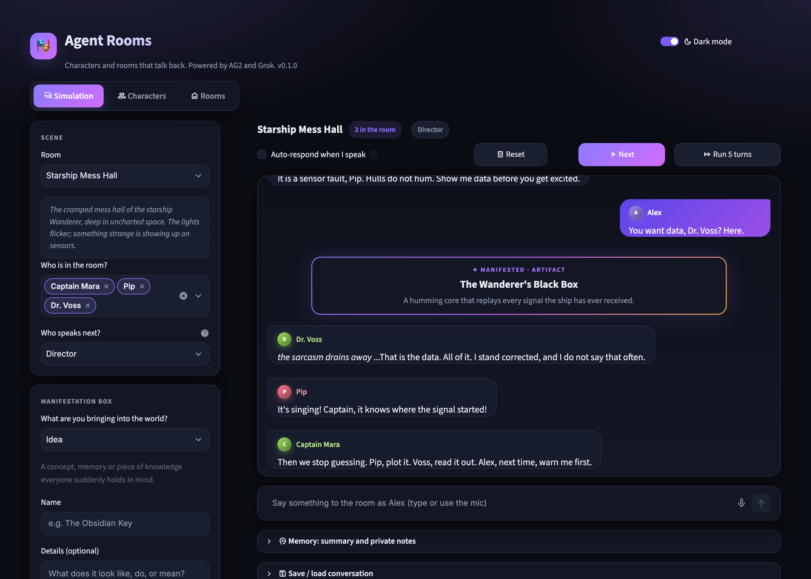

# Agent Rooms

[](https://github.com/pr0digy91/agent-rooms/actions/workflows/ci.yml)
[](pyproject.toml)
[](LICENSE)

A Streamlit app where AI characters live in customizable rooms and talk to each other, and to you. Built on [AG2](https://github.com/ag2ai/ag2) and xAI Grok, with voice in and out.

**Bring your own key:** you need your own [xAI API key](https://console.x.ai) to run it.

**[Watch the demo video](https://youtu.be/8q-_1TJYQTQ)** (4 minutes, with voice).



## Features

- **Characters**: give each one a persona, a behaviour and a voice.
- **Rooms**: define the environment and its rules. Run any cast in any room.
- **You in the scene**: join under your own name and persona, by typing or by voice.
- **Who speaks next**: Director (Grok picks the most natural reply), Round robin or Random. Whoever you address by name replies next.
- **Memory**: a rolling summary of older turns, plus private notes per character.
- **Manifestation box**: introduce an idea, artifact, physical object, entity or phenomenon and every character becomes aware of it at once. Each item has a **conviction** (0-100): how firmly everyone believes in it and what it claims. At 85 or higher it is accepted as plain truth; at 15 or lower it is resisted.
- **Voice**: mic input, spoken replies that autoplay in each character's voice, and tempo and rhythm shaped by the scene and the character's history (Subtle, Natural or Dramatic delivery).
- **Audio devices**: pick your microphone and headphones (headphone routing needs Chrome or Edge).
- **Save and load**: conversations are stored with their memory, manifestations and audio clips.
- **Dark and light themes**.
- **Stored locally** in SQLite: characters, rooms, your player and settings save automatically; conversations save when you press **Save**.

## Requirements

- Python 3.13+ and [uv](https://docs.astral.sh/uv/)
- **Your own xAI (Grok) API key**: nothing runs without one, see below
- A modern browser. Voice works best in Chrome or Edge, and choosing your headphones needs one of those two

## Bring your own key (BYOK)

Agent Rooms does not include an API key or a hosted service. It runs on your machine, calls xAI directly with your key, and every call is billed to your xAI account.

1. Sign in to the [xAI console](https://console.x.ai) and set up billing or credits.
2. Create an API key.
3. Put it in `.env` as `XAI_API_KEY` (see [Setup](#setup)).

**What the key is used for.** If you restrict the key's permissions in the console, it needs access to these:

| Feature | xAI service | Needed |
|---|---|---|
| Character replies, Director, memory, delivery planning | Chat, using the model in `XAI_MODEL` | Always |
| Spoken replies | Text to speech (`/v1/tts`) | When **Speak replies aloud** is on |
| Mic input | Speech to text (`/v1/stt`), using `XAI_STT_MODEL` | When you use the mic |

**Without a key,** the app still opens and you can edit characters and rooms, but pressing **Next** shows `XAI_API_KEY is not set`. Restart Streamlit after adding or changing the key.

**What costs money.** Each turn makes one model call for the reply, and these options add to it:

| Option | Extra calls |
|---|---|
| Director | One model call per turn to choose the speaker, unless you address someone by name |
| Memory | Up to one model call per turn for private notes, plus an occasional summary |
| Speak replies aloud | One text-to-speech call per line |
| Expressive delivery | One model call per spoken line |
| Everyone reacts (manifestation) | A full turn for each character in the room |

To keep costs down, use Round robin, turn Memory off, and leave voice off.

**Keeping your key safe.** The key stays in your local `.env`, which is git-ignored. It is sent only to `api.x.ai` and is not stored in the database. Never commit it or paste it into an issue, and rotate it in the console if it may have leaked. Anyone who can open your running app can spend your credit, so see [SECURITY.md](SECURITY.md) before sharing it on a network.

## Setup

```bash
uv sync
cp .env.example .env
```

Then edit `.env` and add your key:

```env
XAI_API_KEY=your-key-here

# optional
XAI_MODEL=grok-4.20-0309-non-reasoning
XAI_STT_MODEL=grok-voice-transcribe-2.0
XAI_TTS_LANGUAGE=en
XAI_DEFAULT_VOICE=eve
```

`XAI_MODEL` can be any xAI chat model your key has access to.

## Run

```bash
uv run streamlit run app.py
```

Restart the server after pulling changes.

The app has no login, so it only listens on `localhost` (set in `.streamlit/config.toml`). Read [SECURITY.md](SECURITY.md) before changing that.

## Using it

1. **Characters** and **Rooms** tabs: create or edit your cast and settings.
2. **Simulation** tab: pick a room and who is present, then press **Next** or **Run 5 turns**, or type or speak to the room.
3. Tick **Auto-respond when I speak** to get replies without pressing Next.
4. Turn on **Speak replies aloud** under **Options** for voiced replies.
5. Use the **Manifestation box** to change the shared reality and watch the room react.

Every turn is a paid model call on your key. See [What costs money](#bring-your-own-key-byok).

## Data and files

| Path | What it is |
|---|---|
| `agent_rooms.db` | SQLite database holding all your data. Git-ignored; back it up if you care about it. |
| `app.py` | Streamlit UI |
| `sim.py` | Storage, memory, speaker selection, manifestations and turn generation |
| `voice.py` | xAI text-to-speech and speech-to-text |
| `player.py` | Browser audio player and device picker |
| `style.py` | Theme and CSS |

## Tech

AG2 1.1.2 for the agents, xAI Grok (OpenAI-compatible API) for text, the xAI `/v1/tts` and `/v1/stt` endpoints for voice, Streamlit for the UI and SQLite for storage.

## Contributing

Bug reports and pull requests are welcome. See [CONTRIBUTING.md](CONTRIBUTING.md). The tests need no API key:

```bash
uv sync --all-groups
uv run pytest -q
```

## License

[MIT](LICENSE)
